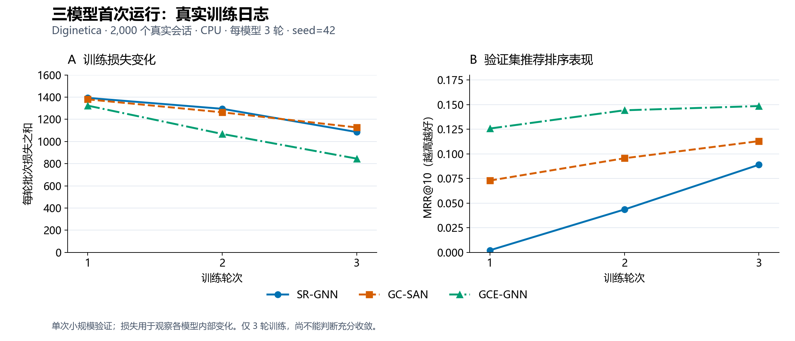

# 当前可展示结果

> 2026-11-02 更新：本页记录 2,000 会话、3 轮的首次 smoke 结果，保留作为历史记录。20,000 会话正式闭环结果见 [正式闭环验收](正式闭环验收.md)。

本页只整理已有实测输出，没有追加训练。范围：2,000个真实会话，每模型CPU训练3轮，单一随机种子。

## 1. 测试集推荐效果与计算成本

每个测试会话只有一个真实下一点击商品，因此Recall@10也等于命中会话占比。MRR@10和NDCG@10同时反映命中商品的排名。

| 模型 | 命中会话/2000 | Recall@10 | MRR@10 | NDCG@10 | 训练及验证/秒 |
|---|---:|---:|---:|---:|---:|
| SR-GNN | 274 | 0.1370 | 0.0864 | 0.0985 | 7.44 |
| GC-SAN | 270 | 0.1350 | 0.0804 | 0.0936 | 10.18 |
| GCE-GNN | 497 | 0.2485 | 0.1518 | 0.1754 | 13.08 |

训练及验证时间包含3轮拟合、验证与检查点保存，不含环境安装和数据准备。该单次CPU用时只用于本轮展示。

## 2. 训练过程

三个模型的训练损失均下降，验证MRR均上升。损失包含各模型各自定义的项，图A用于观察模型内部趋势；图B使用相同的验证指标。尚不能凭3个点断言模型充分收敛。

## 3. 同一真实会话的模型推荐差异

从已导出的前10个测试案例中选取以下两个案例用于说明行为差异；它们不用于估计总体性能。商品为匿名ID，案例均含重复点击。

### 会话 4344

历史浏览：`85558 → 353154 → 353154 → 353154 → 353154 → 353154 → 29575 → 29575`。

实际下一点击：`29575`。

| 模型 | 推荐首位商品 | 真实下一商品在Top-10中的排名 |
|---|---|---|
| SR-GNN | 353154 | 未进入 |
| GC-SAN | 353154 | 2 |
| GCE-GNN | 29575 | 1 |

### 会话 6254

历史浏览：`43004 → 410411 → 70845 → 2650`。

实际下一点击：`2650`。

| 模型 | 推荐首位商品 | 真实下一商品在Top-10中的排名 |
|---|---|---|
| SR-GNN | 206744 | 未进入 |
| GC-SAN | 2650 | 1 |
| GCE-GNN | 70845 | 未进入 |

会话4344中，GCE-GNN把真实下一商品排在第1位；会话6254中，GC-SAN命中第1位，而GCE-GNN未命中Top-10。整体指标较高的模型也会在具体会话上失败。

## 来源

- 原始测试指标与用时：outputs/diginetica-smoke/<模型>/result.json。
- 真实推荐：outputs/diginetica-smoke/<模型>/recommendations.json。
- 训练日志：outputs/console/<模型>-train.log。
- 图形输入快照和来源SHA256：figures/candidates/training_curves.input.json。
- 正式完整数据实验与交互网页尚未实施；本页可用于阶段性展示。
